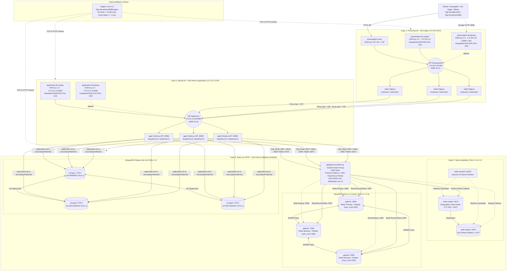

# Diagrama de Arquitectura V2 (ToDo 2 & 3 Completos) — Tarea #995

En esta misma carpeta se encuentra el archivo de imagen listo para entregar:
- **`diagrama_arquitectura_3_capas.jpg`** (Resolución `2100x1420`, formato `.jpg`).

## Código Mermaid Actualizado (Importable en Lucidchart: *Insert -> Advanced -> Mermaid*)

