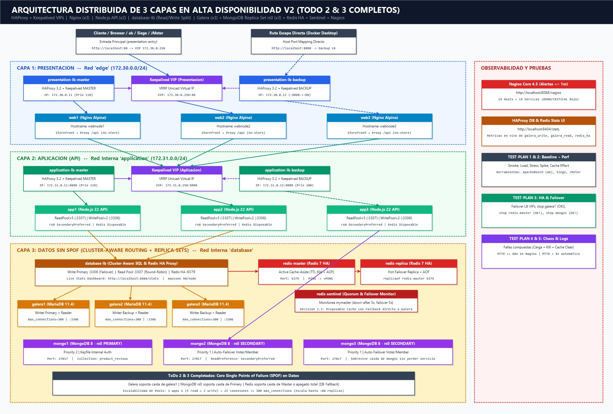

# Tarea #995 — Sistema Distribuido de 3 Capas en Alta Disponibilidad (V2 — ToDo 2 & 3 + TEST-PLAN 1–5)

## 1. Descripción General de la Arquitectura Mejorada (Cero SPOF en Capa de Datos)

Este proyecto implementa una arquitectura distribuida de **3 capas (Presentación, Aplicación y Datos)** altamente disponible, resiliente y escalable mediante **25 contenedores Docker** segmentados en redes aisladas:

- **Capa 1 (Presentación):** Balanceadores **HAProxy 3.2** en par Maestro/Esclavo con **Keepalived (VRRP Unicast)** para la VIP flotante `172.30.0.250` (más puerto de escape `8080` en Docker Desktop) y **3 nodos Web Nginx** (`web1`, `web2`, `web3`).
- **Capa 2 (Aplicación):** Balanceadores internos **HAProxy + Keepalived** sobre la VIP `172.31.0.250:8080` y **3 réplicas Node.js 22 API** (`app1`, `app2`, `app3`) con separación de pools de lectura/escritura y límites acotados de conexión.
- **Capa 3 (Datos sin Puntos Únicos de Fallo):**
  - **Proxy Cluster-Aware (`database-lb`):** Balanceador HAProxy dedicado con endpoint de escritura primaria con failover automático (`:3306`), pool de lectura Round-Robin (`:3307`), endpoint de Redis HA (`:6379`) y tablero en tiempo real (`http://localhost:8404/stats`).
  - **MariaDB Galera Cluster (3 nodos):** `galera1`, `galera2`, `galera3` sincronizados vía WSREP (`--max-connections=300`).
  - **MongoDB 8 Replica Set (`rs0` de 3 nodos):** `mongo1` (Primary inicial, prioridad 2), `mongo2` y `mongo3` (Secondaries con elección automática de primario y lecturas `secondaryPreferred`).
  - **Redis 7 High Availability:** `redis-master` + `redis-replica` con persistencia AOF, monitoreados por `redis-sentinel` y diseñados como caché *Cache-Aside* desechable con fallback automático directo a Galera.
- **Observabilidad:** **Nagios Core 4.5** (`http://localhost:8088/nagios`) monitoreando **19 Hosts y 19 Servicios** con detección `DOWN` / `CRITICAL` (Rojo) en $\le 1\text{ min}$, complementado con **HAProxy Stats** (`http://localhost:8404/stats`) y cabeceras de trazabilidad `X-Request-Trace`.

---

## 2. Mejoras Arquitectónicas Implementadas según `ToDo.md`

| Punto `ToDo.md` | Requerimiento | Solución Arquitectónica Implementada |
| :--- | :--- | :--- |
| **MongoDB (`2.1`)** | Configurar un Replica Set operado correctamente en lugar de instancia única. | Despliegue de Replica Set **`rs0`** de 3 nodos (`mongo1`, `mongo2`, `mongo3`) con autenticación interna por `keyFile`, inicialización automática `rs.initiate()`, lecturas distribuidas con `readPreference=secondaryPreferred` y conmutación automática de `PRIMARY` en ~6–8 s si cae `mongo1` (soportando lecturas `GET` y escrituras `POST 201`). |
| **Redis HA (`2.2`)** | Configurar Redis en modo de Alta Disponibilidad. | Topología **`redis-master` + `redis-replica` + `redis-sentinel`** (`quorum 1`, `down-after 3s`) enrutada a través de `database-lb:6379` mediante healthchecks de capa 7 (`PING` $\rightarrow$ `+PONG`). Si cae `redis-master`, el tráfico conmuta automáticamente a `redis-replica`. |
| **Política de Fallo Redis (`2.3`)** | Decidir si Redis es un caché desechable o si sus datos deben sobrevivir fallos. | **Decisión de Arquitectura:** Redis opera como **caché desechable (*Disposable Cache-Aside*, `TTL=60s`)** respaldado por AOF (`--appendonly yes`) para reinicios tibios. El cliente Node.js usa `disableOfflineQueue: true`, validación `redis.isReady` y timeout máximo de `400 ms`: si **todos** los nodos de Redis caen, la API hace fallback directo al pool de lectura de Galera en `< 45 ms` (`450.23 req/s`) con **`0` errores `500`**. |
| **Galera (`3.1`)** | Dejar de conectar los nodos `app` directamente a `galera1`. | `app1`, `app2`, `app3` y `catalog-init` usan exclusivamente `DB_HOST=database-lb`. Detener `galera1` ya **no tumba el sistema** (`0%` de caída). |
| **Galera (`3.2`)** | Agregar un proxy consciente del clúster para failover y enrutamiento. | Contenedor **`database-lb`** (`haproxy/database-lb.cfg`) con chequeos TCP cada `2s` (`fall 2 rise 2`), `option redispatch`, `retries 3` y panel en vivo en `http://localhost:8404/stats`. |
| **Galera (`3.3`)** | Definir el comportamiento de enrutamiento Lectura/Escritura (*Read/Write Split*). | **Escrituras (`writePool` $\rightarrow$ `database-lb:3306`):** Enrutadas a un único primario activo (`galera1`, con `galera2` y `galera3` en modo `backup`) para evitar conflictos de certificación WSREP y deadlocks multi-master. **Lecturas (`readPool` $\rightarrow$ `database-lb:3307`):** Balanceadas en **Round-Robin** entre `galera1`, `galera2` y `galera3`. |
| **Galera (`3.4`)** | Revisar límites del *connection-pool* conforme escalan las réplicas de `app`. | Cada réplica API acota `DB_READ_POOL_LIMIT=5`, `DB_WRITE_POOL_LIMIT=2` (`7` conexiones máx./réplica) y `DB_POOL_QUEUE_LIMIT=50` con liberación de inactivas (`idleTimeout=30s`), frente a `--max-connections=300` en MariaDB y `maxconn 90` en HAProxy. Con 3 réplicas se usan máximo **21 conexiones (7% de capacidad)**, permitiendo escalar horizontalmente hasta **~40 réplicas de `app`** sin agotar conexiones. |

---

## 3. Resumen de Resultados Reales — `TEST-PLAN.md` (Puntos 1 al 5)

> El reporte exhaustivo con todas las salidas de consola, tablas y comandos manuales se encuentra en `../7_test_plan_completo/REPORTE_TEST_PLAN_1_AL_5.md` junto con el plan ejecutable de JMeter `../7_test_plan_completo/test-plan-tarea995.jmx`.

1. **Punto 1 — Baseline & Chequeos Funcionales:**
   - 24 servicios activos `Up` + `catalog-init` `Exited (0)`; `wsrep_cluster_size = 3`; Replica Set `rs0` con `1 PRIMARY + 2 SECONDARY`; Redis `role:master` con `connected_slaves:1`.
   - Rotación comprobada en `X-Request-Trace`: `webnode1..3`, `app1..3`, `database-lb:read (galera1..3)` y `mongodb-rs0 (mongo2/mongo3)`.
2. **Punto 2 — Pruebas de Rendimiento (`ab`, `Siege`, `JMeter`):**
   - **Smoke (`c=2`):** `191.59 req/s`, `p95 = 37 ms`, `0%` errores.
   - **Load (`c=50`, 2,000 req):** `553.20 req/s`, `p50 = 79 ms`, **`p95 = 174 ms` (cumple SLO `< 200 ms`)**, `0%` errores.
   - **Stress (`c=150`, 3,000 req):** **`727.64 req/s`**, `p50 = 190 ms`, `p95 = 328 ms`, `0%` errores.
   - **Spike (`c=250`, 2,000 req):** `620.45 req/s`, `0%` errores y recuperación inmediata a latencia base.
   - **Efecto Caché (`c=20`, 500 req):** Con Redis activo alcanza **`713.92 req/s` (`p95 = 44 ms`)** frente a **`450.23 req/s` (`p95 = 75 ms`)** con Redis totalmente apagado (mejora de **+58.5% en throughput** y **-41% en latencia p95**).
3. **Punto 3 — Pruebas de HA y Failover:**
   - **Apagado de `galera1`:** Conmutación limpia en `< 4 s` hacia `galera2` (escrituras `:3306`) y `galera2`/`galera3` (lecturas `:3307`) con `HTTP 200 OK`.
   - **Apagado de `redis-master`:** Conmutación transparente a `redis-replica` manteniendo `cache write` y `cache hit`. Al apagar **ambos** nodos Redis, la tienda responde `HTTP 200 OK` leyendo de Galera (`disposable fallback`).
   - **Apagado de `mongo1` (Primary):** `rs0` elige a `mongo2` como nuevo `PRIMARY` en ~6 s; tanto `GET` como `POST /api/products/ST-001/reviews` (`HTTP 201 Created`) funcionan sin caída.
   - **Failover de VIPs Keepalived:** `presentation-lb-backup` (`172.30.0.250` + `:8080`) y `application-lb-backup` (`172.31.0.250`) asumen el tráfico en ~3 s.
4. **Punto 4 — Ingeniería del Caos (Chaos Engineering):**
   - **Falla Compuesta (9 contenedores caídos simultáneamente: `web1`, `web2`, `app2`, `app3`, `application-lb-master`, `keepalived-master`, `galera1`, `mongo1`, `redis-master` + vaciado de caché + carga `ab`):** **300/300 peticiones exitosas (`0` fallos)** a **`862.11 req/s` (`p95 = 21 ms`)**.
   - **Falla de Recuperación Total (`docker compose stop` $\rightarrow$ `docker compose start`):** Arranque en frío exitoso de los 25 servicios con re-bootstrap automático de Galera (`wsrep_cluster_size=3`).
5. **Punto 5 — Observabilidad y Alertas:**
   - **Nagios (`http://localhost:8088/nagios`):** 19 hosts y 19 servicios validados con `0` errores; **MTTD $\le 60\text{ s}$** pasando directamente a `DOWN` / `CRITICAL` (0 falsos `UNKNOWN`).
   - **HAProxy Stats (`http://localhost:8404/stats`):** Visibilidad instantánea de sesiones y estado `UP`/`DOWN`/`BACKUP` de Galera y Redis (**MTTR automático `< 4 s`**).
